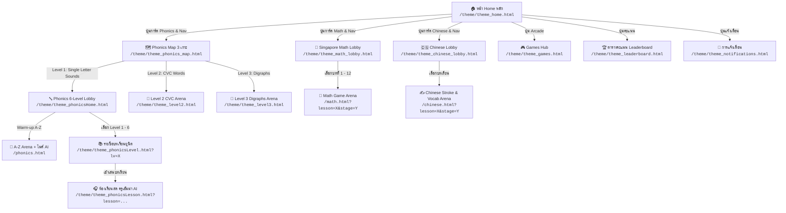

# 🗺️ Kidobits Official System Sitemap & Navigation Flow Architecture

> **เวอร์ชัน:** 2.0 (Pure HTML5 & Tailwind CSS Migration)  
> **อัปเดตล่าสุด:** 16 พฤศจิกายน 2026  
> **โดเมนหลัก:** `https://kidobits.m2igen.com`  
> **มาตรฐานโครงสร้าง:** ทุกหน้าเป็น Pure HTML5 + Tailwind CSS + Vanilla JS (ไม่ใช้ React Bundle อีกต่อไป)

---

## 🧭 แผนผังเส้นทางการนำทาง (Navigation Flow Diagram)

---

## 📋 สารบัญและตารางความสัมพันธ์ของหน้าทั้งหมด (System Route Registry)

### 1. หมวดหมู่หน้าหลัก (Core Hub & Dashboards)

| หน้าจอ | URL Path | เทคโนโลยี | คำอธิบาย |
|---|---|---|---|
| **หน้าแรกของเว็บ** | [`/`](https://kidobits.m2igen.com/) หรือ [`/index.html`](https://kidobits.m2igen.com/index.html) | HTML5 + Tailwind | Landing Page แนะนำหลักสูตรและทางเข้าสู่ระบบ |
| **Home Hub (หลัก)** | [`/theme/theme_home.html`](https://kidobits.m2igen.com/theme/theme_home.html) | HTML5 + Tailwind | ล็อบบี้หลักรวมทุกวิชา, บันทึก Streak 🔥, เหรียญ, อวตาร และเมนูหลัก |
| **เข้าสู่ระบบสมาชิก** | [`/theme/theme_login.html`](https://kidobits.m2igen.com/theme/theme_login.html) | HTML5 + Tailwind | ระบบ Login สมาชิก เชื่อมต่อ OAuth & Central Auth ERP |
| **Sitemap รวมระบบ** | [`/theme/theme_sitemap.html`](https://kidobits.m2igen.com/theme/theme_sitemap.html) | HTML5 + Tailwind | หน้ารวมสารบัญคลิกได้ สำหรับตรวจสอบและทดสอบทุกหน้าจอ |

---

### 2. หมวดหมู่วิชา Phonics (ภาษาอังกฤษ)

| หน้าจอ | URL Path | รายละเอียดบทเรียน |
|---|---|---|
| **แผนที่ 3 เกาะ Phonics** | [`/theme/theme_phonics_map.html`](https://kidobits.m2igen.com/theme/theme_phonics_map.html) | แผนที่การผจญภัย 3 เกาะ (Level 1, Level 2, Level 3) |
| **Phonics 6-Level Master Lobby** | [`/theme/theme_phonicsHome.html`](https://kidobits.m2igen.com/theme/theme_phonicsHome.html) | ศูนย์รวม 6 ระดับ (🐱 Lv1, 🐸 Lv2, 🦊 Lv3, 🐰 Lv4, 🦋 Lv5, 🦉 Lv6) พร้อมปุ่ม Warm-up A-Z |
| **A-Z Warm-up Arena (ไมค์ AI)** | [`/phonics.html`](https://kidobits.m2igen.com/phonics.html) | ฝึกออกเสียง 26 ตัวอักษรเดี่ยว A-Z เทียบเสียงไทย (A=แอะ, B=เบอะ) + ไมค์ตรวจจับเสียง |
| **Level 1 Units Lobby** | [`/theme/theme_phonicsLevel.html?lv=1`](https://kidobits.m2igen.com/theme/theme_phonicsLevel.html?lv=1) | 12 ยูนิต (L1.01 ถึง L1.12) ปลดล็อคตามลำดับ พร้อมระบบ 3 ดาว |
| **Level 2 CVC Lobby** | [`/theme/theme_level2.html`](https://kidobits.m2igen.com/theme/theme_level2.html) | 16 ยูนิต การประสมคำสระสั้น CVC Words |
| **Level 3 Digraphs Lobby** | [`/theme/theme_level3.html`](https://kidobits.m2igen.com/theme/theme_level3.html) | 16 ยูนิต สระผสมและตัวสะกดควบกล้ำ |
| **Level 4 - 6 Lobbies** | [`/theme/theme_phonicsLevel.html?lv=4-6`](https://kidobits.m2igen.com/theme/theme_phonicsLevel.html?lv=4) | Long Vowels, Advanced Morphology, Fluency & Stories |
| **ห้องเรียน Phonics (Interactive Player)** | [`/theme/theme_phonicsLesson.html?lesson=L1.01`](https://kidobits.m2igen.com/theme/theme_phonicsLesson.html?lesson=L1.01) | ตัวเล่นบทเรียนสด เสียงครูเอ็มม่า AI, ตรวจไมค์, ทำแบบทดสอบ |

---

### 3. หมวดหมู่วิชา Singapore Math (คณิตศาสตร์)

| หน้าจอ | URL Path | รายละเอียดบทเรียน |
|---|---|---|
| **Singapore Math Lobby** | [`/theme/theme_math_lobby.html`](https://kidobits.m2igen.com/theme/theme_math_lobby.html) | ล็อบบี้ 12 บทเรียน (ตั้งแต่การนับเลข 1-10 จนถึงการแก้โจทย์ระคน) |
| **Math Interactive Player** | [`/math.html?lesson=1&stage=1`](https://kidobits.m2igen.com/math.html?lesson=1&stage=1) | สังเวียนเกมคณิตศาสตร์ รองรับ Responsive ทั้งแนวตั้งและแนวนอน |
| **Math Stage Selector** | [`/math_exercises.html`](https://kidobits.m2igen.com/math_exercises.html) | แผนผังเลือกด่านฝึกคณิตศาสตร์ |

---

### 4. หมวดหมู่วิชา Chinese (ภาษาจีน)

| หน้าจอ | URL Path | รายละเอียดบทเรียน |
|---|---|---|
| **Chinese Lobby** | [`/theme/theme_chinese_lobby.html`](https://kidobits.m2igen.com/theme/theme_chinese_lobby.html) | ล็อบบี้ 4 ทักษะ (ฟัง, พูด, อ่าน, เขียนพินอิน/ฮั่นจื้อ) อ.1 - ป.6 |
| **Chinese Interactive Player** | [`/chinese.html?lesson=1&stage=1`](https://kidobits.m2igen.com/chinese.html?lesson=1&stage=1) | ตัวเล่นฝึกเขียนอักษรจีน ลำดับขีด (Stroke Order) และเทียบเสียงพินอิน |
| **Chinese Exercises** | [`/chinese_exercises.html`](https://kidobits.m2igen.com/chinese_exercises.html) | แบบฝึกหัดทบทวนคำศัพท์ภาษาจีน |

---

### 5. หมวดหมู่ระบบเสริม & กิจกรรม (Features & Support)

| หน้าจอ | URL Path | คำอธิบาย |
|---|---|---|
| **Games Hub** | [`/theme/theme_games.html`](https://kidobits.m2igen.com/theme/theme_games.html) | ศูนย์รวมมินิเกมพัฒนาทักษะ (Coloring, Space, Music) |
| **Leaderboard** | [`/theme/theme_leaderboard.html`](https://kidobits.m2igen.com/theme/theme_leaderboard.html) | ตารางอันดับเด็กเก่งประจำวัน/สัปดาห์ เชื่อมต่อ ERP |
| **Notifications** | [`/theme/theme_notifications.html`](https://kidobits.m2igen.com/theme/theme_notifications.html) | กล่องข้อความแจ้งเตือนความคืบหน้าและการบ้าน |
| **Reward Admin** | [`/theme/theme_reward_admin.html`](https://kidobits.m2igen.com/theme/theme_reward_admin.html) | ระบบจัดการเหรียญและเหรียญรางวัลพิเศษ |
| **Oliver's Kingdom** | [`/theme/theme_oliver_hub.html`](https://kidobits.m2igen.com/theme/theme_oliver_hub.html) | โซนการเรียนรู้ภาษาอังกฤษเสริมกับมาสคอตนกฮูก Oliver |

---

## 🚫 กฎเหล็กของระบบ (System Rules)
1. **ห้ามลิงก์ไปยังโฟลเดอร์ `archive_react_legacy/`**: ไฟล์ React เก่าทั้งหมดถูกย้ายไปเก็บถาวรในโฟลเดอร์นี้ ห้ามนำกลับมาลิงก์ในหน้าโปรดักชัน
2. **ปุ่ม Navigation บาร์ล่าง (Bottom Nav)**: ต้องใช้ชุด 6 ปุ่มมาตรฐานเสมอ (Home, Phonics, Math, Chinese, Games, Profile)
3. **ห้ามรันเซิร์ฟเวอร์ Local**: รันและทดสอบบน Remote Cloud Server `89.167.82.205` เท่านั้นเพื่อป้องกันพอร์ตชนระบบ ERP
